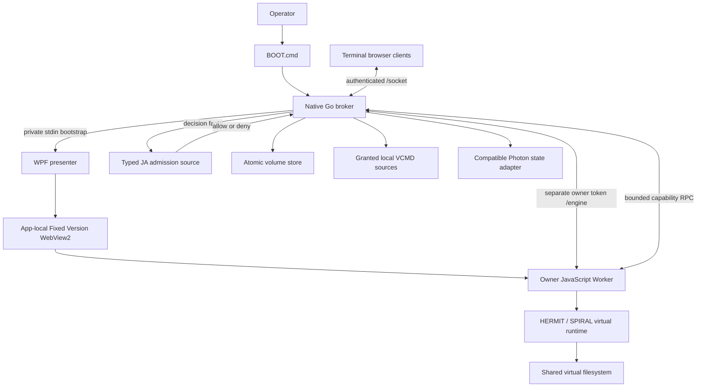

# LK/Vexa Data System

**Copyright (C) 2026 RUSSELL PHILIP SMITHSON**

**Source candidate: 3.0.1 · Platform: Windows 11 x64 · Project license: GPL-3.0-only**

LK/Vexa Data System is a Windows application source distribution combining a native transport broker, a WPF/WebView2 presenter, a browser Worker command engine, a bounded virtual filesystem, source-evaluated admission policy, and a compatible Photon identity/state adapter. The repository includes the application, HERMIT/SPIRAL command implementation, browser interface, VCMD support, native adapters, tests and supporting source material.

**The current 3.0.1 candidate is incomplete and is not an accepted portable release.** Recorded qualification reached 28 passed top-level native test groups before temporary-directory cleanup timed out. A fixture-retention correction exists in source but has not completed a fresh build and acceptance cycle. Subsequent diagnostic processes stalled, and the underlying cause remains unconfirmed. A genuine clean Windows guest was unavailable. Historical 3.0.0 results are documented separately and do not validate this candidate. See [STATUS.md](STATUS.md).

This is a **source repository**, not a complete executable appliance. Precompiled executables, Microsoft browser/runtime binaries, historical archives, user workspaces, credentials and private execution logs are excluded. A source checkout must be built and supplied with the documented Microsoft dependencies before `BOOT.cmd` can start the application.

## Contents

- [1. System scope](#1-system-scope)
- [2. Architecture](#2-architecture)
- [3. Repository organization](#3-repository-organization)
- [4. Platform and dependency contract](#4-platform-and-dependency-contract)
- [5. Build and installation](#5-build-and-installation)
- [6. Single launcher and configuration](#6-single-launcher-and-configuration)
- [7. HTTP interface](#7-http-interface)
- [8. Authentication and ownership](#8-authentication-and-ownership)
- [9. WebSocket and terminal protocols](#9-websocket-and-terminal-protocols)
- [10. JA admission evaluator](#10-ja-admission-evaluator)
- [11. Native capability interface](#11-native-capability-interface)
- [12. Persistence and recovery](#12-persistence-and-recovery)
- [13. Photon state compatibility](#13-photon-state-compatibility)
- [14. Lifecycle and resource bounds](#14-lifecycle-and-resource-bounds)
- [15. Integrity and qualification](#15-integrity-and-qualification)
- [16. Security and operational boundaries](#16-security-and-operational-boundaries)
- [17. Development and contribution](#17-development-and-contribution)
- [18. Licensing and attribution](#18-licensing-and-attribution)

## 1. System scope

Commands execute against the retained JavaScript virtual command model and its virtual filesystem. The native broker supplies transport, controlled source reads, durable volume storage and limited Photon operations. The WPF process hosts the actual WebView2 Worker required for command execution. The broker alone cannot provide a functioning headless command engine.

This implementation does not expose a native Windows shell, general process-execution RPC, arbitrary native filesystem writer or unrestricted network capability to virtual commands. Virtual nodes and fabric placement records describe metadata and host-mediated service placement. They do not establish that WPF, WebView2 or physical infrastructure ran inside a fabric VM.

The JA component is a limited, typed JA source 0.2 admission interpreter. It is not a general JA21 compiler/runtime, MSSL/LCTL VM, hypervisor or assertion of complete R12/MCRT conformance. Photon snapshots cover Photon state; terminal filesystem backup uses volume export and restore. These distinctions are part of the implementation contract.

Legacy identifiers such as `JP300`, `JPBroker`, `JPConsole`, `JA21`, `JP250`, `hermit.vws.v2` and existing schema names remain in source and protocol surfaces for continuity. The repository name does not silently rename persistent schemas or change their compatibility semantics.

## 2. Architecture



| Component | Principal source | Responsibility |
|---|---|---|
| Entry and mode policy | `BOOT.cmd`, `native/boot.go`, `native/policy.go` | Package-relative entry, option validation, isolated defaults and explicit network selection |
| Native broker | `native/main.go`, `server.go`, `websocket.go` | Listener, TLS, bounded HTTP/RFC6455, owner/peer transport and lifecycle |
| Admission evaluator | `native/ja21.go`, `source/jp250-service.ja` | Typed expressions, conditional decisions and reviewed route ABI |
| Windows storage | `native/storage.go` | File identity, single-writer locking, snapshot validation and atomic replacement |
| Photon adapter | `native/photon.go` | Identity binding, canonical state/ledger verification and snapshots |
| Native presenter | `host/*.cs` | CLR/WPF window, WebView2 initialization, portable paths and private session bootstrap |
| Owner engine | `appliance/web/photon-worker.js`, `photon-engine.js` | Owner connection, bounded native RPC and virtual-runtime relay |
| Command runtime | `appliance/web/runtime.js`, `vendor/spiral/` | Sessions, commands, virtual files, persistence and flow control |
| Browser interface | `appliance/web/app.js`, `link.js`, `desktop.js` | Commands/Scripts interface, terminal protocol and native bootstrap handoff |
| Qualification | `native/doctor.go`, `qualification.go`, `*_test.go` | Prerequisite checks, regression runner, managed probe and actual-window smoke workflow |

Transport authentication, policy decisions, virtual execution and persistence are distinct layers. Admission does not convert a virtual command into native execution, and successful transport readiness alone does not prove application readiness.

## 3. Repository organization

| Path | Contents or role |
|---|---|
| `appliance/` | Browser application, retained command engine, protocol modules, VCMD implementation and developer tests |
| `host/` | Native C# presenter and browser/portable-state integration |
| `native/` | Go broker, policy evaluator, Windows adapters and regression source |
| `source/` | Deployed admission profile and retained language/service source |
| `validation/` | Reviewed fixtures and explicitly identified validation material |
| `scripts/Build-Windows.ps1` | Windows developer build and inventory-refresh workflow |
| `runtime/` | Dependency staging location; excluded external binary payloads must be supplied locally |
| `bin/` | Generated native executables and required app-local vendor adapters |
| `workspace/` | Generated mutable application data; excluded from source publication |

The authoritative current-state record is [STATUS.md](STATUS.md). [CONTRIBUTING.md](CONTRIBUTING.md) describes change submissions, and [SECURITY.md](SECURITY.md) describes security reporting and scope. Historical reports must retain their original version and evidence boundaries.

## 4. Platform and dependency contract

The application targets Windows 11 x64 on a writable local drive. The native prerequisite gate requires an x64 process and a Windows build of at least 22000, using the actual OS-version API. UNC/device paths, reparse-point installation paths and network-drive deployment are rejected. Use a reasonably short local extraction/build path; arbitrary deep paths have not been qualified.

Required operational components are:

- Windows .NET Framework CLR/WPF components used by the presenter.
- Locally built x64 `JPBroker.exe` and `JPConsole.exe`, with app-local WebView2 managed adapters and x64 loader.
- The complete official Microsoft Fixed Version WebView2 **155.0.4283.45 x64** distribution in `runtime/webview2-fixed/`.
- The SDK material required by the build, version **1.0.4191.47**, staged under `runtime/webview2-sdk/1.0.4191.47/`.

Go 1.27.2 and the Windows .NET Framework C# compiler are developer build tools. Production startup does not require Go, Python, Node.js or a PowerShell build process. Node is used only for appropriate developer tests, including an optional retained-engine/native-broker integration test.

Normal presenter startup selects the package-local Fixed Version browser and fails if it is missing. It does not automatically download a browser or fall back to an installed Evergreen runtime. Obtain Microsoft components through their official distribution channels and retain their licenses. This repository does not supply those excluded binaries or relicense them under GPL.

See [DEPENDENCIES.md](DEPENDENCIES.md) for official acquisition references, exact staging layout and the recorded reference runtime artifact identity.

Windows 10, ARM64, Windows Server, Windows N optional-media configurations and a freshly installed Windows guest are not qualified deployment claims. An OS-version check is a prerequisite check, not a complete compatibility certification.

## 5. Build and installation

Work from a local Windows checkout. Stage the complete SDK and Fixed Version runtime in the directories above; do not substitute a browser executable without its accompanying vendor files. Review the build script before running it.

```powershell
powershell.exe -NoProfile -File .\scripts\Build-Windows.ps1
```

When Go is not on the developer PATH, pass its explicit executable:

```powershell
powershell.exe -NoProfile -File .\scripts\Build-Windows.ps1 `
  -GoExe "C:\DeveloperTools\go\bin\go.exe"
```

The workflow builds the native broker and precompiled regression executable, compiles the C# presenter with the staged SDK and Windows framework references, places the required adapters beside the presenter, and refreshes integrity inventories. It does not automatically acquire dependencies. See [native/BUILD.md](native/BUILD.md) and the build script for the exact build contract.

Generated outputs are expected under `bin/`: `JPBroker.exe`, `JPTests.exe`, `JPConsole.exe`, the managed WebView2 assemblies and `WebView2Loader.dll`. A successful compiler exit does not establish full application acceptance. Run the verification and qualification steps described below and inspect the resulting evidence before distributing a new executable package.

Changing immutable source or binaries invalidates previous inventory values. Regenerate the presenter inner seal and outer `SHA256SUMS.txt` as part of the reviewed build. The inner presenter's retained **9.8.7 ABI identifier** is separate from application version 3.0.1. Do not bypass failed verification to launch modified bytes.

## 6. Single launcher and configuration

`BOOT.cmd` is the single supported command entry. It invokes the package-local broker directly, preserves the caller's working directory and disables delayed expansion. Quote paths containing spaces, `&` or `!`. Relative script/report paths resolve from the calling directory; package assets resolve from the executable location.

| Invocation | Behavior |
|---|---|
| `BOOT.cmd` | Local console at `http://127.0.0.1:8877` |
| `BOOT.cmd --local --port 8878` | Local console on another unprivileged port |
| `BOOT.cmd --network` | Reviewed configuration with mandatory TLS |
| `BOOT.cmd --network --show-token` | TLS network mode with explicit terminal-token display |
| `BOOT.cmd --lan-unsafe ...` | Explicit plaintext HTTP/WS isolated-network test mode |
| `BOOT.cmd --vcmd "example.vcmd"` | Isolated standalone virtual-command job |
| `BOOT.cmd --doctor` | Offline prerequisites and diagnostics |
| `BOOT.cmd --verify` | Immutable inventory and policy-source verification |
| `BOOT.cmd --self-test` | Quick native checks |
| `BOOT.cmd --qualify` | Packaged regressions, managed probe and actual-window smoke test |
| `BOOT.cmd --test` | Qualification alias |
| `BOOT.cmd --restore "export.json"` | Validated volume restore with previous-volume backup |
| `BOOT.cmd --help` | Current supported modes |

Local mode ignores `server-config.json` and rejects options that would override its network isolation. Network mode requires certificate and private-key configuration and enforces TLS even if a configuration requests insecure operation. Explicit LAN test mode ignores configuration-file/TLS settings and requires its settings directly; it has no additional confirmation dialog.

Configuration fields are restricted to `host`, `port`, `publicOrigin`, `allowedOrigins`, `tlsCert`, `tlsKey`, `allowInsecureNetwork` and `vcmdRoots`. Unknown fields, duplicate options and incompatible mode combinations are rejected. Bind addresses must be explicit IP addresses; ports are 1024–65535. TLS minimum is 1.2. Operators supply certificates and client trust; no automatic trust-store modification or certificate issuance is implemented.

Standalone VCMD binds only loopback on an OS-assigned ephemeral port, rejects network overrides, requires its native window and uses an isolated in-memory terminal volume. `--check`, `--trace` and `--report` require `--vcmd`. Explicit `--vcmd-root` grants control included native source reads.

## 7. HTTP interface

| Endpoint | Method | Semantics |
|---|---|---|
| `/health` | GET, HEAD | Transport liveness and engine phase |
| `/ready` | GET, HEAD | HTTP 503 until the owner engine is ready |
| `/capabilities` | GET, HEAD | Execution boundaries, authorization model and limits |
| `/socket` | GET upgrade | Authenticated terminal-peer WebSocket |
| `/engine` | GET upgrade | Separately authenticated owner WebSocket |
| `/` and admitted assets | GET, HEAD | Static application content rooted under `appliance/web/` |

The purpose-built HTTP/1.1 parser accepts bounded origin-form requests. It rejects duplicate/non-ASCII headers, malformed CRLF, query strings, fragments, backslashes, target controls and unsupported methods. Transfer-Encoding is refused; Content-Length, when present, must be exactly `0`. HTTP responses close their connection.

Host must match the configured set exactly. An HTTP Origin, when present, must match an allowed canonical origin; socket upgrades require one. Origins have lowercase canonical spelling, omit default ports and exclude credentials, paths, wildcards, queries and fragments. There is no wildcard CORS, cookie session or query-token authentication mechanism.

Static suffixes are limited to `.html`, `.js`, `.css`, `.json`, `.svg`, `.png`, `.ico` and `.vcmd`. Decoded path components reject traversal, reserved devices, streams, invalid characters and trailing dot/space aliases. Responses use no-store, nosniff, no-referrer and a restrictive CSP with same-origin scripts/styles/workers and explicit connection origins.

## 8. Authentication and ownership

Each broker instance generates independent cryptographically random **32-byte** terminal and owner secrets, represented as 64-character hexadecimal strings. The terminal secret conveys shared client authority; the owner secret authorizes the single engine connection. Secrets are compared in constant time.

The broker supplies the native presenter with protocol-2 JSON through redirected stdin, including exact origin and both credentials. Bootstrap size is bounded to 2048 bytes/characters at the respective native/managed boundaries. Credentials are not passed as command-line arguments. A private qualification workspace field is validated and removed before browser session configuration.

The first socket message must be text JSON containing exactly `type: "auth"` and `token`, within five seconds. The endpoint determines which secret is required. Authentication occurs after strict handshake origin/host checks. Terminal connections are refused until engine readiness; only one owner and at most eight terminal peers are admitted.

This is shared bearer authentication. It does not implement individual accounts, roles, tenant isolation, enterprise federation or per-user audit identity. Sessions share the virtual filesystem. Protect explicitly displayed tokens and TLS private keys according to the deployment's own access-control requirements.

## 9. WebSocket and terminal protocols

Transport follows the implemented RFC6455 subset: version 13, a canonical Base64 16-byte handshake key, masked client frames, zero RSV bits, valid opcodes, minimal extended lengths and validated UTF-8 text/close reasons. If a subprotocol is supplied, it must be exactly `hermit.vws.v2`. Compression/extensions are not negotiated.

The inner terminal binary frame is:

```text
byte 0       kind: 1 = input, 2 = output
bytes 1..6   unsigned sequence, big-endian, 1..2^48-1
bytes 7..n   nonempty payload, at most 16384 bytes
```

Input sequences must advance by exactly one. Runtime input payload is further limited to 8192 bytes. JSON controls require protocol `v:2`, a string type, matching session identity, an optional request ID of at most 80 characters and an object payload when present.

Output uses cumulative credit with a 262144-byte window and a 262144-byte queue; emitted chunks are at most 16384 bytes. Large control responses require a request identifier and acknowledgment within ten seconds, with only one outstanding large control response. These mechanisms bound application queues and slow consumers; they are not a general distributed congestion-control specification.

The owner Worker relays peer messages and invokes native capabilities asynchronously. It limits outstanding RPCs to 16, applies a 15-second capability timeout, caps queued engine events at 512 and sends a heartbeat every 20 seconds. Owner transport and terminal input have separate message ceilings.

## 10. JA admission evaluator

`source/jp250-service.ja` is parsed, type-checked and evaluated by `native/ja21.go`. Profile identifier is `jp250.ja02.hosted.1`. Decisions carry the source SHA-256 and a statement trace; statement identifiers derive from source identity, location and statement kind.

The required preamble declares `ja source 0.2`, a module, one reviewed `use JP250`, and the policies `no_execute_unknown_code`, `no_hidden_network` and `explicit_host_abi`. Supported statements are `let`, `assert`, conditional `when` and decision-only `route JP250 <- ...`. Types include Text, checked signed 64-bit integer/Count, Flag, Record, Array and Hash within the implemented subset. Reviewed intrinsics include text size and SHA-256 text hashing. Boolean operators short circuit.

Immutable input facts describe transport, method, path, operation, token validity, loopback status, verified origin, readiness, owner status and body size. These facts originate in broker state, not caller assertions. Current source admits declared public HTTP operations, authenticated engine/client sockets and the enumerated authenticated owner capabilities, subject to readiness and size conditions.

Unsupported syntax, imports, policies, types, arithmetic, absent/ambiguous routes, returned-operation mismatch and inconsistent decision status fail closed. Source is limited to 1 MiB of valid UTF-8, with parser nesting/token/statement bounds. The route cannot perform host I/O. Valid reviewed source changes alter admission on the next process start; no hot-reload or complete JA language-conformance claim is made.

## 11. Native capability interface

| Owner RPC | Accepted arguments | Native effect |
|---|---|---|
| `store.read` | none | Read/validate selected volume snapshot |
| `store.write` | exactly `record` | Validate and persist snapshot, or copy into isolated memory store |
| `local.read` | `path`, optional `parent` | Read a granted bounded UTF-8 `.vcmd` source |
| `photon` | exactly `action` | `status`, `verify` or `snapshot` only |

Source grants accept at most eight retained directory identities. Only `.vcmd` files under those roots are readable, with a 524288-byte ceiling, valid UTF-8 and `#!vcmd 1` first-line header. BOM removal and CRLF normalization are explicit. Network URLs, UNC/device/alternate-stream paths, traversal and root escapes are refused; root identity is checked before and after reading.

Browser imports use bounded ordered chunks and optional source SHA-256 validation. Import commits create new virtual files rather than overwriting existing sources, and imports do not automatically execute. Native source grants likewise grant reading, not host execution or writing.

## 12. Persistence and recovery

Normal terminal state is stored in `workspace/server/volume.json` using `JA21-VOLUME/1`. A missing initial record permits seeding; corrupt, invalid or over-quota existing data fails startup without silently replacing the original.

Validation requires a version-1 directory-root snapshot, at most 1500 nodes, depth at most 64, paths at most 4096 UTF-16 units, components at most 255 units and at most 2097152 decoded file bytes. Encoded records are limited to 6 MiB. File content is UTF-8 or canonical Base64. Names, metadata, duplicates and timestamps are checked.

Windows file operations reject symlinks/reparse points and multiply linked ordinary files. Reads compare named and opened file identities before and after I/O and hold a read-sharing handle that excludes writers/replacement. A persistent `server.lock` uses nonblocking exclusive `LockFileEx`; ownership lasts for the open handle. The lock file is not deleted during shutdown. Its filename alone does not establish that another process is alive.

Snapshot replacement writes a same-directory temporary file, synchronizes it, closes it, rechecks the target and uses `MoveFileExW` with replacement/write-through flags. Runtime dirty-state accounting advances only after successful persistence, repeating if intervening mutations occurred. Commands, explicit synchronization/export and orderly shutdown invoke the persistence path.

Restore validates a bounded `JA21-VOLUME/1` or `JA21-EXPORT/1`, acquires the volume lock and preserves the previous volume as a new timestamped backup before replacement. The supplied export remains unchanged. Stop the relevant application before manual recovery, preserve the entire workspace and investigate corrupt state rather than deleting evidence to force a factory seed. Photon snapshots do not substitute for terminal exports.

## 13. Photon state compatibility

The native bridge implements compatible Generic Photon 0.2.0 canonical JSON/hash conventions and binds one console identity of the form `vec1-<24 lowercase hexadecimal characters>`. It verifies identity continuity, canonical state SHA-256, genome/capability hashes, schema/policy, ledger sequence/hash chain and the recorded ledger-head anchor.

Content-addressed snapshots validate their envelope, identity/generation relationship and sealed state. Snapshot authorization requires the current identity or an ancestor and an authorizing source-ledger snapshot event. Ambiguous or altered state is refused rather than silently replaced with another identity.

The exposed operations are status, verify and snapshot. Native four-node execution is explicitly reported as **NOT RUN / NOT BOUND by this adapter**. Hashes and ledgers are local, unkeyed integrity structures; they do not establish external attestation, cryptographic authorship, immutable remote consensus or physical execution.

## 14. Lifecycle and resource bounds

Owner phases include disconnected, initializing, ready, halted and stopped. Disconnect clears readiness and closes peers. Graceful stop settles virtual commands, flushes state and sends `engine.stopped` with success only after completion. Missing acknowledgment can produce exit 74 and an explicit persistence warning. Interrupt uses exit 130.

| Boundary | Implemented limit |
|---|---|
| HTTP header / target | 8192 bytes total / 2048 target characters |
| HTTP parsed lines | At most 44 including request/terminator |
| Static asset | 6 MiB |
| Initial socket authentication | 512 bytes / 5 seconds |
| Owner message | 8 MiB |
| Terminal incoming message | 16384 bytes |
| Terminal input rate | 250 messages or 65536 bytes per second |
| Owner native RPC rate | 100 per second |
| Data fragments / control payload | 128 per message / 125 bytes |
| Ping/pong control rate | 32 per ten seconds |
| Session open / expiry / idle | 5 seconds / 2 hours / 15 minutes |
| Engine initialization / native startup | 30 seconds / 60 seconds |
| Broker stop acknowledgment budget | 8 seconds |
| Native-child exit allowance after shutdown | 3 seconds |

WebSocket writes are serialized with deadlines and pending-byte backpressure. HTTP busy admission applies beyond 32 tracked connections. These controls address specific resource paths; they do not constitute comprehensive hostile-network denial-of-service assurance or guaranteed service latency.

## 15. Integrity and qualification

The outer SHA-256 inventory checks immutable bytes and exact coverage, rejecting duplicate aliases, traversal and unexpected executable caches. Mutable exclusions include `workspace/`, `certs/` and `server-config.json`; Git metadata and inventory self-references are also excluded. Current source hashes large renderer files with a fixed 1 MiB streaming buffer. The corresponding candidate rebuild remains part of pending acceptance.

`--qualify` is designed to run precompiled regressions without target compilation, restrict PATH to Windows directories, use package-local temporary data, probe the actual CLR/WPF/SDK/Fixed browser, and launch the real native presenter/Worker against an isolated VCMD smoke workflow. Output checks include file readback, Photon verification/snapshot, successful result and graceful persistence acknowledgment.

| Evidence scope | Recorded status |
|---|---|
| Current 3.0.1 native qualification | Incomplete; 28 groups passed before cleanup timeout |
| Current fixture-retention correction | Source present; fresh build/acceptance pending |
| Genuine clean Windows machine | Not performed; suitable guest unavailable |
| Historical 3.0.0 native suite | 44 top-level groups passed; historical scope only |
| Historical retained JavaScript suite | 83 tests passed; historical scope only |
| Historical native window/Worker and standalone execution | Observed in 3.0.0; not current-candidate acceptance |

Qualification reports deliberately set `cleanMachineCertified:false`. Neither a new folder, restricted PATH nor operator-provided flag proves a clean OS. Independent guest provenance and a complete successful run remain necessary. Unsigned inventories also do not authenticate their own publisher or make a modified candidate equivalent to an accepted release.

## 16. Security and operational boundaries

Trusted components include the local Windows account/OS, reviewed native executables, the owner Worker, admission source and its evaluator, application source, vendor browser/SDK and deployment configuration. The model does not defend against an administrator or same-user adversary able to replace the application and its inventories.

Use local mode for a local console. Network operation requires deliberate origin, certificate, key and exposure decisions. Plaintext LAN mode exposes bearer authority to network observation and is limited to explicitly selected test use. The application does not claim independent penetration testing, regulatory accreditation, formal verification, multi-tenant separation or a service-level agreement.

Mutable data stays under the application workspace by design, but Windows and vendor components can create operating-system artifacts. Portability does not mean forensic absence of registry, event, cache or security-product records. See [SECURITY.md](SECURITY.md) for reporting instructions and avoid publishing credentials or user data in issues.

## 17. Development and contribution

Use separate writable working folders, retain failing fixtures and distinguish source review from executed evidence. Native tests cover policy, framing, TLS, storage, source grants, Photon compatibility and lifecycle. The optional Node integration exercises retained JavaScript against actual native sockets; it supplements actual-window testing rather than substituting for it.

Contributions should identify affected protocol/schema boundaries, preserve compatibility identifiers unless migration is explicit, include meaningful targeted validation and update status when acceptance remains incomplete. Changes to policy, persistence, dependency versions or bundled runtime assembly require corresponding documentation and inventory review. Do not present historical totals as a current regression result. See [CONTRIBUTING.md](CONTRIBUTING.md).

## 18. Licensing and attribution

Project-owned source is offered under the **GNU General Public License, version 3 only (`GPL-3.0-only`)**, with the requested attribution:

> LK/Vexa Data System — Copyright (C) 2026 RUSSELL PHILIP SMITHSON

Read [LICENSE](LICENSE), [NOTICE](NOTICE), [COPYRIGHT](COPYRIGHT), [LICENSING.md](LICENSING.md) and [THIRD_PARTY_NOTICES.md](THIRD_PARTY_NOTICES.md). Preserve applicable upstream notices and provenance. Independently licensed third-party material remains subject to its own terms. Microsoft WebView2/browser/SDK components are not relicensed by the project GPL and their excluded binary distributions must be acquired and handled under their applicable vendor terms.

The repository is provided with the warranty limitations stated in the license. A project name, copyright notice or detailed architecture document does not imply a registered legal institution, third-party endorsement or operational certification.
